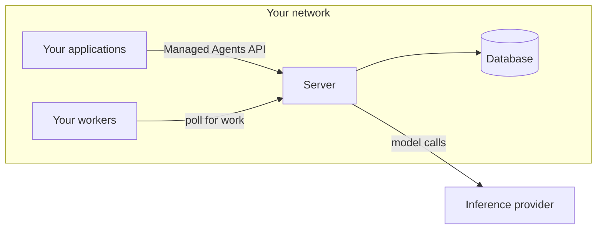

<!-- source: https://platform.claude.com/docs/en/managed-agents/self-hosted / last verified: 2026-11-14 -->

# Self-hosted Claude Managed Agents

Managed Agents on your own infrastructure (a cloud account or an on-premise data center). You host the service and the sandboxes; the model runs at Anthropic or at an inference provider that you choose.

## Signature / Usage

Who hosts what:

| Option | Sandboxes | Service | Model |
|--------|-----------|---------|-------|
| Cloud sandboxes (default) | Anthropic | Anthropic | Anthropic |
| Self-hosted sandboxes | You | Anthropic | Anthropic |
| Self-hosted Managed Agents | You | You | Anthropic, or a provider that you choose |

Components of one deployment:

## Options / Props

Components:

| Component | Role |
|-----------|------|
| Server (`cma-server`) | Serves the API, runs the agent loop, stores agents, sessions, and each session's history. Calls your inference provider for the model. Never runs an agent's shell or file tools. |
| Database | PostgreSQL 16 or later. Without a database the server keeps data in memory and a restart erases it. |
| Workers | Take work from the server and run the agent's shell and file tools in your sandboxes. An `ant beta:worker` command or an SDK worker. |
| Your applications | Reach the server with the SDK or the `ant` CLI. |
| Console on your server | A webpage at the server's address; people sign in through your identity provider. |
| Admin CLI (`cma-server-admin`) | Creates environments and their environment keys. Runs on Linux (x86-64 and Arm) and macOS on Apple silicon. |

The three credentials:

| Credential | Who holds it | What it authenticates |
|------------|--------------|-----------------------|
| Server API key | Your applications, the `ant` CLI, and the admin CLI | Requests to your server. Setup generates it. Plays the role a Claude API key plays with the hosted service. |
| Inference credential | The server | The server's model calls to your inference provider (for example a Claude API key, a cloud provider credential, or the token your model gateway accepts). Applications and workers don't need it. |
| Environment key | Your workers that poll the server | One environment's work queue and that environment's sessions. |

### When to choose it

- Storage on your infrastructure: you must store agents, sessions, and session history yourself.
- Your choice of inference provider: model calls must go to Amazon Bedrock, Claude Models on Google Cloud (Google managed), Microsoft Foundry, or your own model gateway.
- If you only need tools to run on your infrastructure, use self-hosted sandboxes (Anthropic runs the service).

## Notes

- To request access to self-hosted Claude Managed Agents (and the download), contact your Anthropic account team. The server software is licensed under the Software License Agreement: Claude Managed Agents Server (https://www.anthropic.com/legal/self-hosted-managed-agents-license).
- Distinct from `self_hosted` environments / self-hosted sandboxes (workers; see `../environments/self-hosted-sandboxes.md`): with self-hosted Claude Managed Agents you host the whole service (server + database + workers); with self-hosted sandboxes Anthropic hosts the service and you host only the tool-execution worker.
- Your server has the same API as the hosted service, so the SDK, the `ant` CLI, and the rest of the Managed Agents documentation apply, except for the documented differences from the hosted service.
- You run and secure the server, its database, and your sandboxes, and you install each release yourself. Some features exist only on the hosted service.
- Security: the agent's `bash` tool is a real shell with the worker process's permissions and network access; the worker doesn't isolate it. Isolation comes from what the worker runs in. The Docker Compose stack and the `cma-sandboxes` Helm chart start each session's worker in its own container or pod. If you start a worker yourself, run it in a disposable container or VM that holds nothing you need to protect.
- The self-hosted sandboxes Security model applies, with two differences: what that page assigns to Anthropic is your responsibility (securing the server, hosting memory stores, detecting unusual usage), and each trust level needs its own deployment (see Multitenancy in `./data-and-access.md`).
- What leaves your network: for each model call the server sends the conversation so far, including tool inputs and tool results, to your inference provider (the Claude API by default). A call to the Claude API also carries the IDs of its session, agent, and environment. See `./data-and-access.md`.
- Each release's archive includes an operator guide for that version, `operator-guide.md`; have Claude read it to help configure and run the server and write connecting code.
- Source: https://platform.claude.com/docs/en/managed-agents/self-hosted.md (fetched 2026-11-14).

## Related

- [Get started](./quickstart.md)
- [Console on your server](./console.md)
- [Single sign-on](./single-sign-on.md)
- [Data and access](./data-and-access.md)
- [Self-hosted sandboxes](../environments/self-hosted-sandboxes.md)
