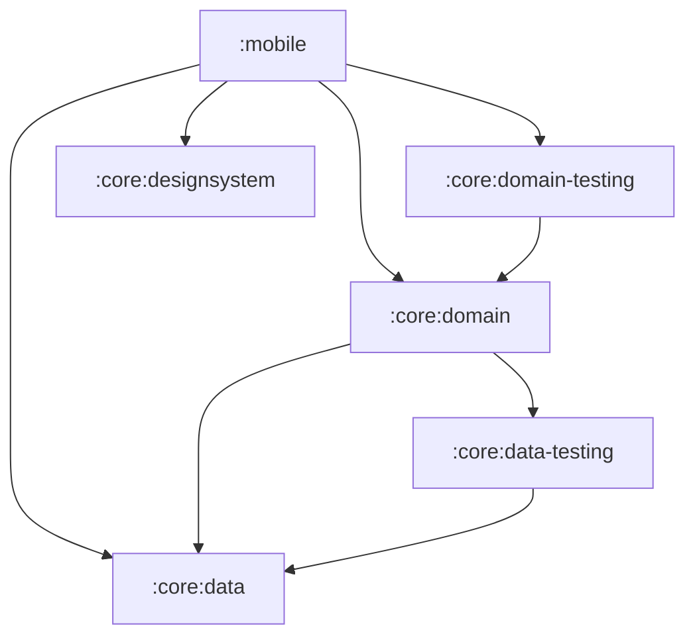

# Migrating a Jetpack Compose app to Kotlin Multiplatform

Convert an Android library module's build script to a Kotlin Multiplatform module, following the module-by-module Jetcaster migration.

Module build script before the migration:

```kotlin
plugins {
    alias(libs.plugins.android.library)
}

android {
    namespace = "com.example.jetcaster.core.data"
    compileSdk = 37

    defaultConfig {
        minSdk = 23
    }
}

dependencies {
    // Dependency example
    implementation(libs.koin.core)
}
```

Module build script as a Kotlin Multiplatform module:

```kotlin
plugins {
    alias(libs.plugins.kotlin.multiplatform)
    alias(libs.plugins.android.kotlin.multiplatform.library)
}

kotlin {
    android {
        namespace = "com.example.jetcaster.core.data"
        compileSdk = 37
        minSdk = 23
    }

    jvmToolchain(17)
    iosArm64()
    iosSimulatorArm64()
    jvm()
    wasmJs { browser() }

    sourceSets {
        commonMain.dependencies {
            // Dependency example
            implementation(libs.koin.core)
        }
    }
}
```

Module dependency graph used to pick the migration order (leaf modules first):



## Notes

- Source project: Jetcaster (`https://github.com/android/compose-samples/tree/main/Jetcaster`), migrated in `https://github.com/kotlin-hands-on/jetcaster-kmp-migration` (`step-by-step-migration` branch has one working commit per step; `main` holds the final state).
- Order of work in the guide: migrate to multiplatform libraries (Dagger/Hilt to Koin, Coil 2 to Coil 3, ROME to RSS Parser, JUnit to `kotlin-test`, `AnnotatedString.fromHtml()` to `htmlconverter`, `android.net.Uri` to `uri-kmp`), rewrite Java-only code (`Objects.hash()`, `java.time` to `kotlin.time` / `kotlinx-datetime`), migrate modules leaf-first, move UI screen by screen to Compose Multiplatform, then add JVM / iOS / web entry points.
- Source layout moves from `src/main/java` to `src/commonMain/kotlin`, `src/androidMain/kotlin`, and so on; each module declares only targets that exist at that step, and `wasmJs` is added last with the web entry point.
- Android resource differences called out: the resource directory is `composeResources` instead of `res`, `@android:color` usages need hex codes, and the generated accessor class is `Res` instead of `R`. Platform-specific pieces (database builder, dynamic color scheme, IO dispatcher, feed list) use `expect` / `actual`.
- Commit a shared Xcode scheme (`YourApp.xcodeproj/xcshareddata/xcschemes/`) so `xcodebuild -scheme YourApp` works on any machine. The web app runs with the `:wasmApp:wasmJsBrowserDevelopmentRun` Gradle task.
