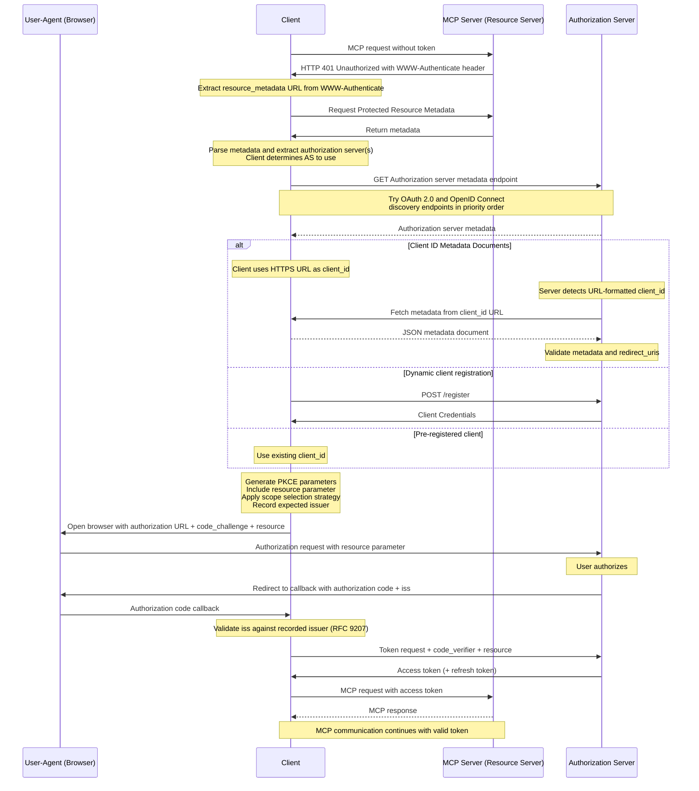

# Authorization Flow Steps

The complete authorization flow, plus the required validation of the authorization response (`iss`, RFC 9207).

## Signature / Usage

## Options / Props

Authorization Response Validation. Before redirecting the user-agent, the client **MUST** record the `issuer` value from the selected authorization server's validated metadata document and associate it with the same per-request record used to store the PKCE code verifier (and the `state` value, if used). On receiving the authorization response, MCP clients **MUST** apply RFC9207 Section 2.4 validation before transmitting the authorization code to any token endpoint:

| `authorization_response_iss_parameter_supported` | `iss` in response | Client action |
| --- | --- | --- |
| `true` | present | Compare to the recorded issuer using simple string comparison (RFC3986 Section 6.2.1) |
| `true` | absent | Reject the response |
| `false` or absent | present | Compare to the recorded issuer using simple string comparison (RFC3986 Section 6.2.1) |
| `false` or absent | absent | Proceed |

## Notes

- MCP authorization servers **SHOULD** include the `iss` parameter in authorization responses, including error responses (RFC9207 Section 2). Servers that include it **MUST** advertise `authorization_response_iss_parameter_supported: true` in their metadata.
- The third row applies the local-policy provision in RFC9207 Section 2.4: a present `iss` is compared against the recorded issuer regardless of metadata advertisement.
- A future revision is expected to upgrade authorization server inclusion of `iss` from **SHOULD** to **MUST**; client rejection behavior on `iss` absence will continue to be keyed on `authorization_response_iss_parameter_supported` until then.
- After decoding `iss` from the `application/x-www-form-urlencoded` response, clients **MUST NOT** apply scheme or host case folding, default-port elision, trailing-slash, or percent-encoding normalization before comparison.
- Validation applies equally to error responses; on mismatch the client **MUST NOT** act on or display `error`, `error_description`, or `error_uri`.
- The validation provides no protection if the expected issuer was obtained from an unvalidated source.
- Source: tag `2026-07-28` raw, `docs/specification/2026-07-28/basic/authorization/index.mdx` sections "Authorization Flow Steps" and "Authorization Response Validation".

## Related

- [Authorization Server Discovery](./authorization-server-discovery.md)
- [Resource Parameter Implementation](./resource-parameter.md)
- [Authorization Security Considerations](./authorization-security.md)
