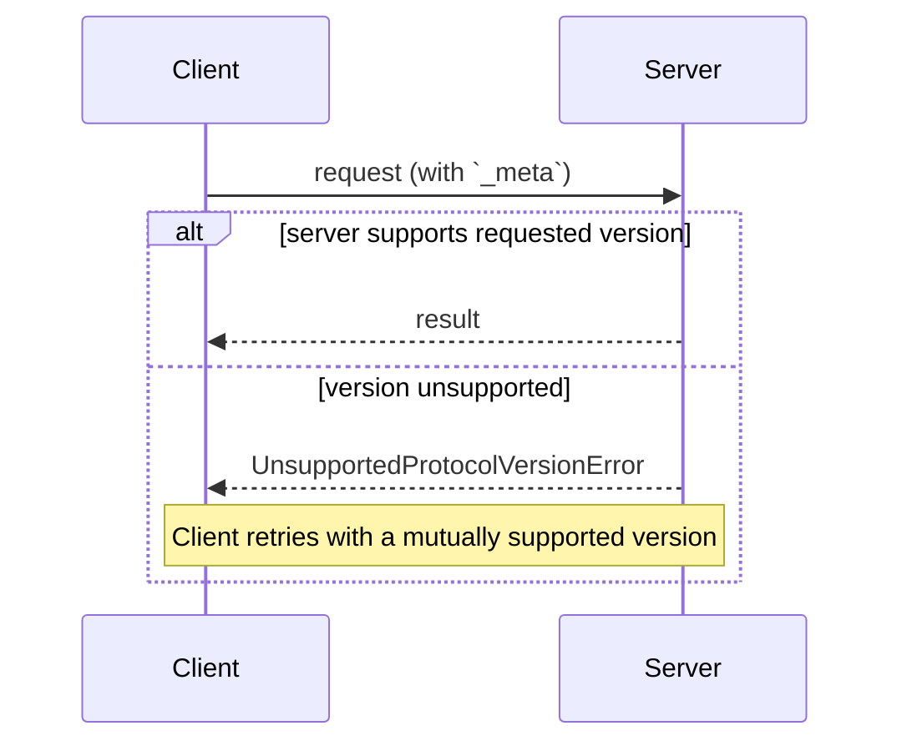

# Protocol Version Negotiation

There is no negotiation handshake. Every request carries its protocol version, and the server accepts or rejects each request independently.

## Signature / Usage

```json
{
  "jsonrpc": "2.0",
  "id": 1,
  "error": {
    "code": -32022,
    "message": "Unsupported protocol version",
    "data": {
      "supported": ["2026-07-28", "2025-11-25"],
      "requested": "1900-01-01"
    }
  }
}
```



## Notes

- Terminology: **Modern** = versions that convey version, identity, and capabilities as per-request metadata (`2026-07-28` and later); **Legacy** = versions that establish a session with an `initialize` handshake (`2025-11-25` and earlier); **Dual-era** = an implementation supporting both.
- Every request declares its protocol version in `_meta`; on HTTP it is also carried in the `MCP-Protocol-Version` header.
- If the server does not implement the requested version (unknown, or known but unsupported), it **MUST** respond with `UnsupportedProtocolVersionError` (`-32022`) listing the versions it supports.
- The client **SHOULD** select a mutually supported version from the `supported` list and retry, or surface an error if none is compatible.
- Servers **MUST** implement `server/discover`. Clients **MAY** call it before other requests to learn supported versions up front, but are not required to: a client may invoke any RPC inline and handle `UnsupportedProtocolVersionError`.
- Replaced in 2026-07-28: version negotiation in `initialize` is replaced by per-request `io.modelcontextprotocol/protocolVersion` in `_meta`.

## Related

- [_meta](./meta-field.md)
- [Extension Negotiation](./extension-negotiation.md)
- [Backward Compatibility with Initialization-Based Versions](./backward-compatibility.md)
- [Responses and Error Codes](./responses-and-errors.md)
