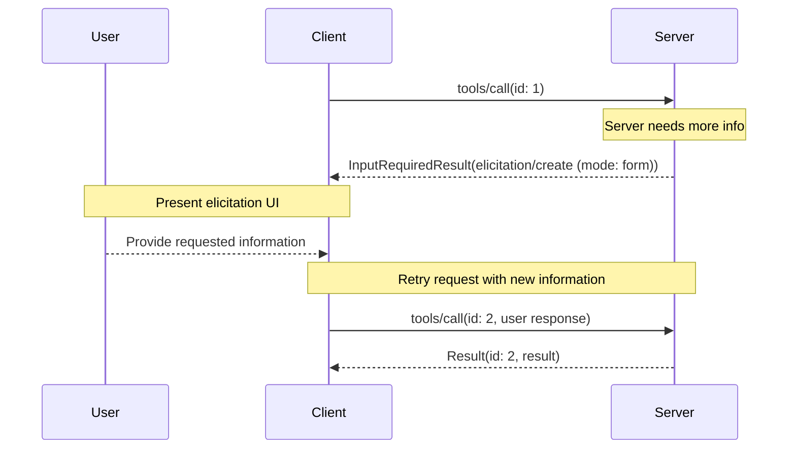

# Form Mode Elicitation

Form mode lets servers collect structured data directly through the MCP client, with a restricted JSON Schema (`requestedSchema`) describing the expected response.

## Signature / Usage

Form mode requests **MUST** either specify `mode: "form"` or omit `mode`, and include `requestedSchema`.

Input request (delivered inside `InputRequiredResult.inputRequests`):

```json
{
  "method": "elicitation/create",
  "params": {
    "mode": "form",
    "message": "Please provide your contact information",
    "requestedSchema": {
      "type": "object",
      "properties": {
        "name": {
          "type": "string",
          "description": "Your full name"
        },
        "email": {
          "type": "string",
          "format": "email",
          "description": "Your email address"
        },
        "age": {
          "type": "number",
          "minimum": 18,
          "description": "Your age"
        }
      },
      "required": ["name", "email"]
    }
  }
}
```

Client result (returned inside `inputResponses` on the retried request):

```json
{
  "action": "accept",
  "content": {
    "name": "Monalisa Octocat",
    "email": "octocat@github.com",
    "age": 30
  }
}
```



## Options / Props

| Name | Type | Description |
|------|------|-------------|
| `requestedSchema` | object | A JSON Schema defining the structure of the expected response |

Schemas are limited to flat objects with primitive properties. Supported primitive schemas:

String (supported formats: `email`, `uri`, `date`, `date-time`):

```json
{
  "type": "string",
  "title": "Display Name",
  "description": "Description text",
  "minLength": 3,
  "maxLength": 50,
  "format": "email",
  "default": "user@example.com"
}
```

Number:

```json
{
  "type": "number", // or "integer"
  "title": "Display Name",
  "description": "Description text",
  "minimum": 0,
  "maximum": 100,
  "default": 50
}
```

Boolean:

```json
{
  "type": "boolean",
  "title": "Display Name",
  "description": "Description text",
  "default": false
}
```

Enum, single-select without titles (`enum`), single-select with titles (`oneOf` with `const` / `title`):

```json
{
  "type": "string",
  "title": "Color Selection",
  "description": "Choose your favorite color",
  "oneOf": [
    { "const": "#FF0000", "title": "Red" },
    { "const": "#00FF00", "title": "Green" },
    { "const": "#0000FF", "title": "Blue" }
  ],
  "default": "#FF0000"
}
```

Enum, multi-select without titles (`items.enum`) and with titles (`items.anyOf`):

```json
{
  "type": "array",
  "title": "Color Selection",
  "description": "Choose your favorite colors",
  "minItems": 1,
  "maxItems": 2,
  "items": {
    "anyOf": [
      { "const": "#FF0000", "title": "Red" },
      { "const": "#00FF00", "title": "Green" },
      { "const": "#0000FF", "title": "Blue" }
    ]
  },
  "default": ["#FF0000", "#00FF00"]
}
```

## Notes

- Complex nested structures, arrays of objects (beyond enums), and other advanced JSON Schema features are intentionally not supported, to simplify client user experience.
- All primitive types support optional defaults; clients that support defaults **SHOULD** pre-populate form fields with them. Clients can use the schema to generate input forms, validate input before sending, and guide users.
- Replaced in 2026-07-28: server-initiated `elicitation/create` is delivered through `InputRequiredResult` (Multi Round-Trip pattern) rather than a server-to-client request.
- Form mode security: servers **MUST NOT** request sensitive information (passwords, API keys, etc.) via form mode; clients **SHOULD** validate all responses against the provided schema; servers **SHOULD** validate that received data matches the requested schema. Servers **SHOULD NOT** include URLs intended to be clickable in any field of a form mode request.
- Source: tag `2026-07-28` raw (`docs/specification/2026-07-28/client/elicitation.mdx`, sections Form Mode Elicitation Requests, Form Mode Flow, Form Mode Security).

## Related

- [Elicitation](./elicitation.md)
- [URL Mode Elicitation](./elicitation-url-mode.md)
- [Multi Round-Trip Requests (MRTR)](../patterns/mrtr.md)
