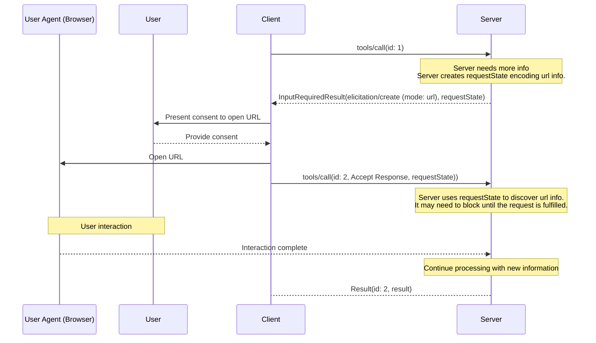

# URL Mode Elicitation

URL mode lets servers direct users to external URLs for out-of-band interactions that must not pass through the MCP client, such as auth flows, payment processing, and entering sensitive data.

## Signature / Usage

URL mode requests **MUST** specify `mode: "url"`, a `message`, and a `url` (which **MUST** contain a valid URL).

Input request (delivered inside `InputRequiredResult.inputRequests`):

```json
{
  "method": "elicitation/create",
  "params": {
    "mode": "url",
    "url": "https://mcp.example.com/ui/set_api_key",
    "message": "Please provide your API key to continue."
  }
}
```

Client result (returned inside `inputResponses` on the retried request):

```json
{
  "action": "accept"
}
```

`action: "accept"` indicates the user consented to the interaction, not that it is complete. The interaction occurs out of band and the client is not directly informed of the outcome. On retry, the server determines from the echoed `requestState` (or its own stored state) whether the out-of-band interaction completed, and either returns the final result or responds with another `InputRequiredResult`.



## Options / Props

| Name | Type | Description |
|------|------|-------------|
| `mode` | string | `"url"` |
| `message` | string | Human-readable message explaining why the interaction is needed |
| `url` | string | The URL that the user should navigate to |

## Notes

- URL mode is not for authorizing the MCP client's access to the MCP server (that is MCP authorization). It is used when the MCP server needs sensitive information or third-party authorization on behalf of the user; the client's bearer token remains unchanged and the client's only responsibility is to give the user context about the URL.
- The source marks URL mode as introduced in the `2025-11-25` version of the specification; its design and implementation may change in future revisions.
- Removed in 2026-07-28: `notifications/elicitation/complete` and `elicitationId` (per the 2026-07-28 changelog summary). Clients **SHOULD** provide manual controls that let the user retry or cancel the original request.
- Sensitive data pattern: the server directs users to an HTTPS page on a trusted domain, users enter credentials directly, the server stores them bound to the user's identity, and later MCP requests use them. Credentials never pass through the LLM context, MCP client, or intermediate servers.
- OAuth flows: servers act as OAuth clients to third-party resource servers. MCP servers **MUST NOT** rely on URL mode to authorize users for themselves. Requirements: third-party credentials **MUST NOT** transit through the MCP client; the server **MUST NOT** use the client's credentials for the third-party service (token passthrough is forbidden); the user **MUST** authorize the MCP server directly out of band; the server is responsible for storing and managing third-party tokens. The server **MUST NOT** transmit credentials obtained through URL mode to the MCP client.
- Phishing: the server **MUST** verify the identity of the user who opens the URL before accepting information, and ensure the user who started the elicitation is the same user who completes the authorization flow (e.g. a "connect URL" on the MCP server that checks the session cookie's subject against the authorization server `sub`, before redirecting to the third-party authorize endpoint). The mechanism **MUST** be resilient to an attacker modifying the elicitation URL.
- Safe URL handling, servers: **MUST NOT** include sensitive end-user information (credentials, PII) in the URL; **MUST NOT** provide a pre-authenticated URL to a protected resource; **SHOULD** use HTTPS for non-development environments.
- Safe URL handling, clients: **MUST NOT** pre-fetch the URL or its metadata; **MUST NOT** open the URL without explicit user consent; **MUST** show the full URL before consent; **MUST** open it in a secure manner that does not let the client or LLM inspect content or user inputs (the source cites SFSafariViewController as good and WKWebView as not on iOS); **SHOULD** highlight the domain, warn on ambiguous or suspicious URIs (e.g. Punycode), and not render URLs as clickable in any elicitation field except the `url` field.
- Source: tag `2026-07-28` raw (`docs/specification/2026-07-28/client/elicitation.mdx`, sections URL Mode Elicitation Requests, URL Mode Flow, URL Mode Elicitation for Sensitive Data, URL Mode Elicitation for OAuth Flows, Safe URL Handling).

## Related

- [Elicitation](./elicitation.md)
- [Form Mode Elicitation](./elicitation-form-mode.md)
- [Multi Round-Trip Requests (MRTR)](../patterns/mrtr.md)
