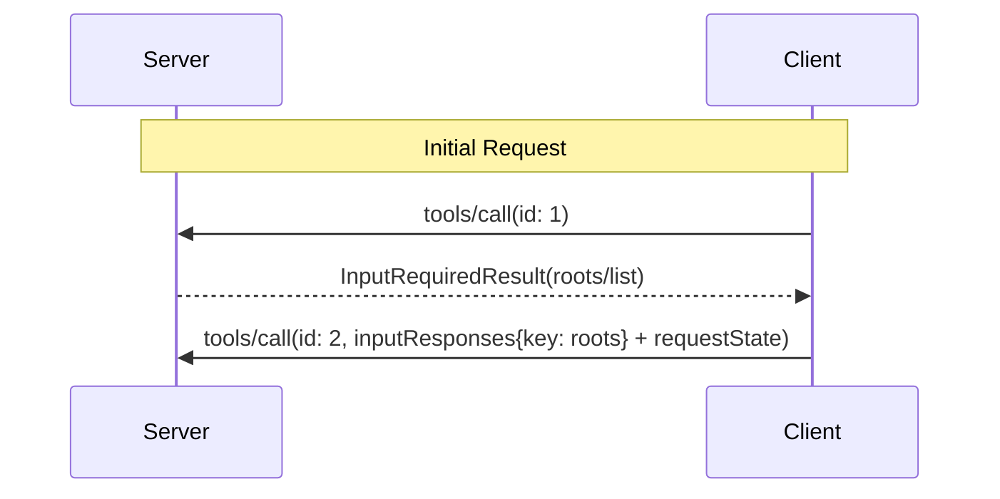

# Roots (Deprecated)

Clients expose filesystem "roots" to servers, informing them which directories and files the client considers relevant. Roots are informational guidance, not an access-control mechanism; the protocol does not enforce that servers stay within roots.

## Signature / Usage

Clients that support roots **MUST** declare the `roots` capability in `_meta.io.modelcontextprotocol/clientCapabilities` on each request:

```json
{
  "_meta": {
    "io.modelcontextprotocol/clientCapabilities": {
      "roots": {}
    }
  }
}
```

To retrieve roots while processing a client request, servers send an `InputRequiredResult` containing a `roots/list` request.

Input request (delivered inside `InputRequiredResult.inputRequests`):

```json
{
  "method": "roots/list"
}
```

Client result (returned inside `inputResponses` on the retried request):

```json
{
  "roots": [
    {
      "uri": "file:///home/user/projects/myproject",
      "name": "My Project"
    }
  ]
}
```



## Options / Props

Root:

| Name | Type | Description |
|------|------|-------------|
| `uri` | string | Unique identifier for the root. **MUST** be a `file://` URI in the current specification |
| `name` | string (optional) | Human-readable name for display purposes |

## Notes

- Deprecated in 2026-07-28 (earliest removal: first revision on or after 2027-07-28): the Roots feature is deprecated as of protocol version `2026-07-28` (SEP-2577). It remains in the specification for at least twelve months after this revision's release under the feature lifecycle policy. New implementations **SHOULD NOT** adopt it; existing implementations **SHOULD** migrate to passing directories or files via tool parameters, resource URIs, or server configuration.
- Replaced in 2026-07-28: the server-initiated `roots/list` request is now delivered through the Multi Round-Trip pattern (`InputRequiredResult.inputRequests`, answered via `inputResponses` on the retried request).
- Removed in 2026-07-28: `notifications/roots/list_changed` (per the 2026-07-28 changelog summary).
- If an error occurs, the client does not need to replay the initial call with an error message, because the server is not waiting for a response with the `InputRequiredResult` pattern.
- Clients **MUST**: only expose roots with appropriate permissions; validate all root URIs to prevent path traversal; implement proper access controls; monitor root accessibility.
- Servers **SHOULD**: handle cases where roots become unavailable; respect root boundaries during operations; validate all paths against provided roots.
- Clients **SHOULD**: prompt users for consent before exposing roots; provide clear UIs for root management; validate root accessibility before exposing; monitor for root changes. Servers **SHOULD** check for the roots capability before usage and cache root information appropriately.
- Source: tag `2026-07-28` raw (`docs/specification/2026-07-28/client/roots.mdx`).

## Related

- [Multi Round-Trip Requests (MRTR)](../patterns/mrtr.md)
- [Deprecated Features](../overview/deprecated-features.md)
- [Sampling (Deprecated)](./sampling.md)
- [Elicitation](./elicitation.md)
