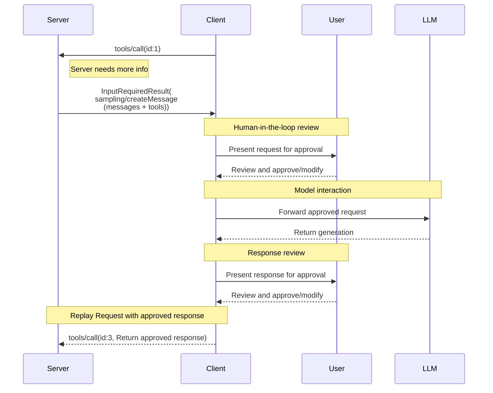

# Sampling (Deprecated)

Servers request LLM sampling ("completions" or "generations") from language models via clients. The client keeps control over model access, selection, and permissions, and no server API keys are necessary. Servers can request text, audio, or image-based interactions.

## Signature / Usage

Clients that support sampling **MUST** declare the `sampling` capability in `_meta.io.modelcontextprotocol/clientCapabilities` on each request:

```json
{
  "_meta": {
    "io.modelcontextprotocol/clientCapabilities": {
      "sampling": {}
    }
  }
}
```

Servers send an `InputRequiredResult` containing a `sampling/createMessage` request. Input request (delivered inside `InputRequiredResult.inputRequests`):

```json
{
  "method": "sampling/createMessage",
  "params": {
    "messages": [
      {
        "role": "user",
        "content": {
          "type": "text",
          "text": "What is the capital of France?"
        }
      }
    ],
    "modelPreferences": {
      "hints": [
        {
          "name": "claude-3-sonnet"
        }
      ],
      "costPriority": 0.3,
      "intelligencePriority": 0.8,
      "speedPriority": 0.5
    },
    "temperature": 0.1,
    "systemPrompt": "You are a helpful assistant.",
    "maxTokens": 100
  }
}
```

Client result (returned inside `inputResponses` on the retried request):

```json
{
  "role": "assistant",
  "content": {
    "type": "text",
    "text": "The capital of France is Paris."
  },
  "model": "claude-3-sonnet-20240307",
  "stopReason": "endTurn"
}
```



## Options / Props

Request parameters and result fields:

| Name | Type | Description |
|------|------|-------------|
| `messages` | array | Sampling messages. Each **MUST** have `role` (`"user"` or `"assistant"`) and `content`. The list **SHOULD NOT** be retained between separate requests |
| `modelPreferences` | object | `costPriority`, `speedPriority`, `intelligencePriority` (normalized 0-1) and optional `hints` |
| `systemPrompt` | string (optional) | Requested system prompt. The client **MAY** modify or ignore it without telling the server |
| `includeContext` | `"none"` / `"thisServer"` / `"allServers"` | Context the client is expected to include. `"thisServer"` and `"allServers"` are deprecated. The client **MAY** modify or ignore it |
| `temperature` | number | Randomness control. Valid range depends on the model provider. Client **MAY** modify or ignore |
| `maxTokens` | number | Maximum tokens to generate; required. The client **MUST** respect it |
| `stopSequences` | string[] | Sequences that stop generation. Client **MAY** modify or ignore |
| `metadata` | object | Additional provider-specific parameters. Client **MAY** modify or ignore |
| `tools` / `toolChoice` | array / object | Tool-enabled sampling; see Sampling with Tools |
| result `role` | string | Message role |
| result `content` | content block or array | A single block, or an array when the response has multiple blocks (e.g. multiple tool uses) |
| result `model` | string | Name of the model that generated the message |
| result `stopReason` | string | Non-exhaustive: `"endTurn"`, `"stopSequence"`, `"maxTokens"`, `"toolUse"`. Implementations **MAY** provide their own values |

Content types:

```json
{ "type": "text", "text": "The message content" }
```

```json
{ "type": "image", "data": "base64-encoded-image-data", "mimeType": "image/jpeg" }
```

```json
{ "type": "audio", "data": "base64-encoded-audio-data", "mimeType": "audio/wav" }
```

Model preferences: hints are treated as substrings matching model names flexibly, multiple hints are evaluated in order of preference, clients **MAY** map hints to equivalent models from different providers, and hints are advisory (clients make the final model selection).

```json
{
  "hints": [
    { "name": "claude-3-sonnet" }, // Prefer Sonnet-class models
    { "name": "claude" } // Fall back to any Claude model
  ],
  "costPriority": 0.3, // Cost is less important
  "speedPriority": 0.8, // Speed is very important
  "intelligencePriority": 0.5 // Moderate capability needs
}
```

## Notes

- Deprecated in 2026-07-28 (earliest removal: first revision on or after 2027-07-28): the Sampling feature is deprecated as of protocol version `2026-07-28` (SEP-2577). New implementations **SHOULD NOT** adopt it; existing implementations **SHOULD** migrate to integrating directly with LLM provider APIs.
- Deprecated in 2025-11-25 (reclassified under the SEP-2596 feature lifecycle policy in 2026-07-28): `includeContext` values `"thisServer"` and `"allServers"`. They will be removed no later than the Sampling feature itself. Servers **SHOULD** avoid them (omit `includeContext`; it defaults to `"none"`) and **SHOULD NOT** use them unless the client declares the `sampling.context` capability (`{"sampling": {"context": {}}}`).
- The upstream example sets `includeContext: "thisServer"`; it is omitted from the example above because that value is deprecated (defaults to `"none"`).
- Replaced in 2026-07-28: server-initiated `sampling/createMessage` is delivered via the Multi Round-Trip pattern (`InputRequiredResult.inputRequests` / `inputResponses`) instead of a server-to-client request.
- There **SHOULD** always be a human in the loop with the ability to deny sampling requests. Applications **SHOULD** provide UI to review requests, allow users to view and edit prompts before sending, and present generated responses for review before delivery.
- If an error occurs or the user declines, the client does not need to replay the initial call with an error message, as the server is not waiting for a response with the `InputRequiredResult` pattern.
- Security: clients **SHOULD** implement user approval controls, rate limiting, and respect model preference hints; both parties **SHOULD** validate message content and **MUST** handle sensitive data appropriately.
- Tool-enabled sampling is described in the Sampling with Tools page.
- Source: tag `2026-07-28` raw (`docs/specification/2026-07-28/client/sampling.mdx`).

## Related

- [Sampling with Tools](./sampling-with-tools.md)
- [Multi Round-Trip Requests (MRTR)](../patterns/mrtr.md)
- [Deprecated Features](../overview/deprecated-features.md)
- [Roots (Deprecated)](./roots.md)
- [Elicitation](./elicitation.md)
