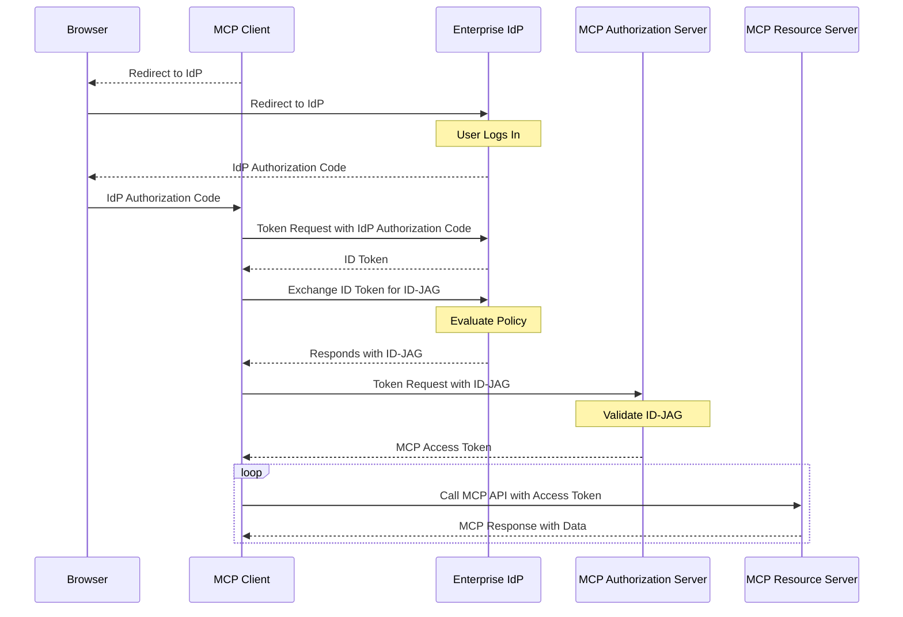

# Enterprise-Managed Authorization

The `io.modelcontextprotocol/enterprise-managed-authorization` extension lets organizations control MCP server access centrally through their existing identity provider (IdP) instead of each employee authorizing each MCP server individually.

## Signature / Usage

Client declares support in per-request capabilities:

```jsonc
{
  "jsonrpc": "2.0",
  "id": 1,
  "method": "...",
  "params": {
    // Other fields...
    "_meta": {
      // Other fields...
      "io.modelcontextprotocol/clientCapabilities": {
        "extensions": {
          "io.modelcontextprotocol/enterprise-managed-authorization": {},
        },
      },
    },
  },
}
```

Flow: the client obtains an Identity Assertion JWT Authorization Grant (ID-JAG) from the enterprise IdP, then exchanges it for an access token at the MCP server's Authorization Server.



## Notes

- Source: tag `2026-07-28` raw, retrieved 2026-10-16 (unversioned site path `/extensions/`). The normative specification is in the ext-auth repository (not reproduced here); the source page also references SEP-990.
- Key aspects: centralized policy at the IdP, single sign-on, policy enforcement before token issuance (group membership, role assignments, conditional access), and centralized revocation at the IdP level.
- Client requirements, as listed in the source: declare support; support SSO and save the Identity Assertion (OpenID ID Token or SAML assertion); request an ID-JAG from the enterprise IdP and exchange it at the MCP Authorization Server, without redirecting the user to the MCP Authorization Server's authorization endpoint; support organization-level IdP configuration; handle scope errors gracefully.
- Servers: declare the extension in authorization metadata, indicating clients must use the enterprise-managed flow; optionally publish a resource descriptor for IdP admin consoles.
- MCP Authorization Servers: validate ID-JAGs (JWT signature against the IdP JWKS, audience, issuer, expiration); map IdP claims (scope and resource information) to permissions; for account linking use the subject claim as the primary stable identifier and fall back to the email claim for pre-existing accounts.
- Typically requires client-level support from the organization's IT team in addition to the MCP client application. Extensions are opt-in and never active by default.
- Spec requirements here; concrete OAuth provider implementations are in better-auth and supabase.

## Related

- [Authorization Extensions](./auth-extensions.md)
- [OAuth Client Credentials](./oauth-client-credentials.md)
- [Extension Client Matrix](./client-matrix.md)
