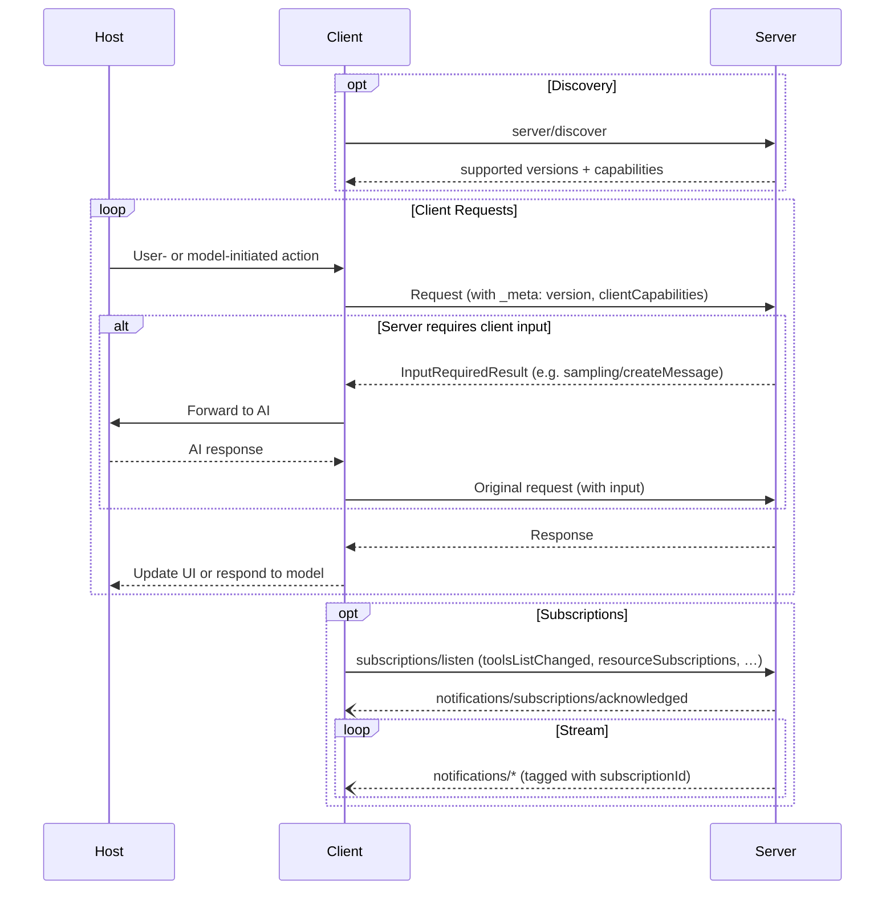

# Architecture

Client-host-server architecture: each host runs multiple clients, each client talks to exactly one server. MCP is stateless; every request carries its own protocol version and capabilities.

## Signature / Usage

### Core Components

**Host** (container and coordinator):

- Creates and manages multiple client instances
- Controls client connection permissions and lifecycle
- Enforces security policies and consent requirements
- Handles user authorization decisions
- Coordinates AI/LLM integration and sampling
- Manages context aggregation across clients

**Clients** (created by the host, 1:1 with a server):

- Communicates with exactly one server
- Attaches protocol version and capabilities to every request
- Routes protocol messages bidirectionally
- Manages subscriptions and notifications
- Maintains security boundaries between servers

**Servers**:

- Expose resources, tools and prompts via MCP primitives
- Operate independently with focused responsibilities
- Request client input (sampling, elicitation, roots) via `InputRequiredResult` within a reply
- Must respect security constraints
- Can be local processes or remote services

### Design Principles

1. Servers should be extremely easy to build (hosts handle complex orchestration)
2. Servers should be highly composable
3. Servers should not be able to read the whole conversation, nor "see into" other servers (full conversation history stays with the host; cross-server interactions are controlled by the host)
4. Features can be added to servers and clients progressively (capabilities negotiated as needed; backwards compatibility is maintained)

### Capability Negotiation

Clients and servers declare supported features on each request.

- Clients include their capabilities in `_meta.io.modelcontextprotocol/clientCapabilities` on every request.
- Servers advertise their capabilities in response to `server/discover`, which clients may call before any other request for up-front capability discovery.
- Both parties must respect declared capabilities throughout the interaction.
- Additional capabilities can be negotiated through extensions.

Examples of per-request unlocking:

- Implemented server features must be advertised in the server's capabilities.
- Receiving resource update notifications requires opening a `subscriptions/listen` stream with the desired resource URIs.
- Tool invocation requires the server to declare tool capabilities.

## Notes

- Replaced in 2026-07-28: the `initialize` / `notifications/initialized` handshake (capabilities now travel in `_meta` on each request) and server-initiated requests such as `sampling/createMessage` (now delivered inside `InputRequiredResult`, see the MRTR pattern).
- Sampling, Roots and Logging are Deprecated in 2026-07-28 (see `deprecated-features.md`).

## Related

- [Specification Overview](./specification-overview.md)
- [Key Changes (2026-07-28)](./key-changes.md)
- [Architecture Overview (concepts)](./concepts-architecture.md)
