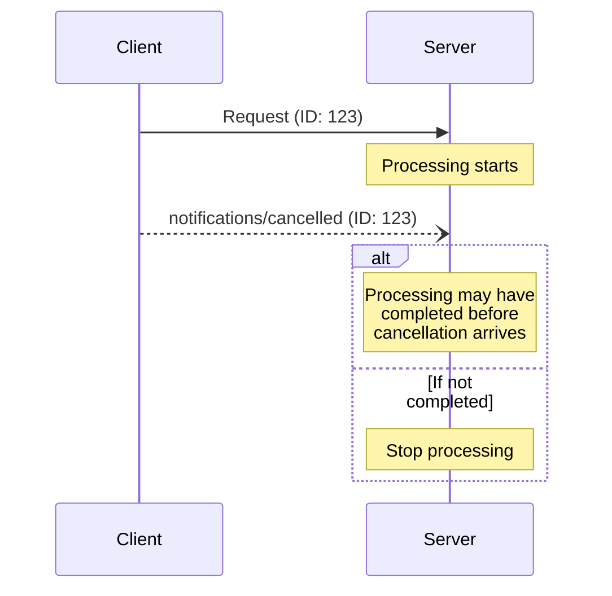

# Cancellation

Optional cancellation of in-progress requests through notification messages. A client **SHOULD** send a cancellation notification to indicate that a request it previously issued should be terminated.

## Signature / Usage

```json
{
  "jsonrpc": "2.0",
  "method": "notifications/cancelled",
  "params": {
    "requestId": "123",
    "reason": "User requested cancellation"
  }
}
```

The notification contains the ID of the request to cancel and an optional reason string that can be logged or displayed.



## Options / Props

| Name | Type | Description |
|------|------|-------------|
| `requestId` | string / integer | ID of the request to cancel |
| `reason` | string (optional) | Reason that can be logged or displayed |

## Notes

- A server **MUST** send `notifications/cancelled` referencing a `subscriptions/listen` request ID when it tears down that subscription stream. Servers **MUST NOT** send `notifications/cancelled` for any other purpose.
- Transport-specific cancellation:
  - Streamable HTTP: closing the SSE response stream is the cancellation signal. The server **MUST** treat a client disconnect as cancellation of that request. No `notifications/cancelled` message is required or expected.
  - stdio: there is no per-request stream to close. The client **MUST** send a `notifications/cancelled` notification referencing the request ID.
- Timeouts: implementations **SHOULD** establish timeouts for all sent requests. On timeout the sender **SHOULD** cancel the request (close the response stream on Streamable HTTP; send `notifications/cancelled` on stdio) and stop waiting. SDKs and middleware **SHOULD** allow per-request timeout configuration.
- Implementations **MAY** reset the timeout clock when receiving a progress notification for the request, but **SHOULD** always enforce a maximum timeout.
- Behavior requirements:
  - Cancellation notifications **MUST** only reference requests that were previously issued by the client and are believed to still be in progress.
  - Server-sent cancellation notifications **MUST** reference a `subscriptions/listen` request.
  - Servers receiving cancellation **SHOULD** stop processing, free associated resources, and not send a response for the cancelled request.
  - Servers **MAY** ignore cancellation if the referenced request is unknown, processing already completed, or the request cannot be cancelled.
  - The client **SHOULD** ignore any response to the cancelled request that arrives afterward.
- Race conditions: cancellation may arrive after processing completed or after a response was sent; both parties **MUST** handle this gracefully. Invalid cancellation notifications (unknown request IDs, already completed requests, malformed notifications) **SHOULD** be ignored.
- Both parties **SHOULD** log cancellation reasons for debugging; application UIs **SHOULD** indicate when cancellation is requested.
- Source: tag `2026-07-28` raw (`docs/specification/2026-07-28/basic/patterns/cancellation.mdx`).

## Related

- [Subscriptions](./subscriptions.md)
- [Progress](./progress.md)
- [Message Patterns Overview](./patterns-overview.md)
