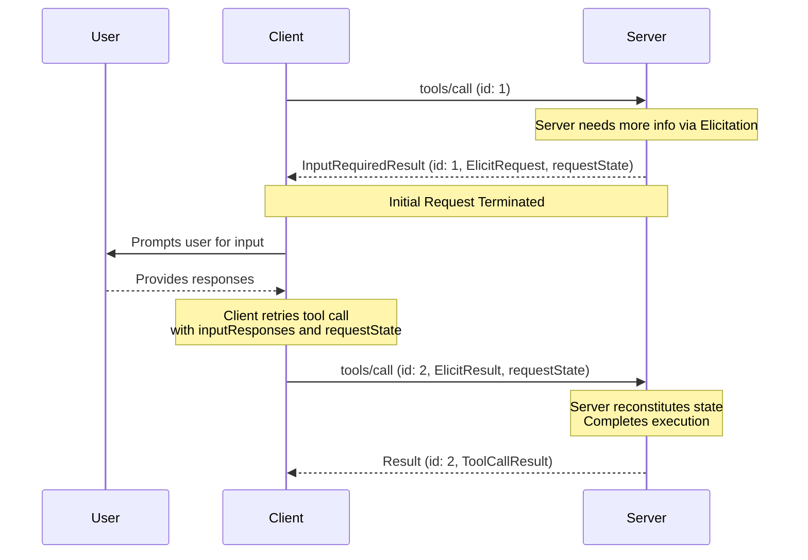

# Multi Round-Trip Requests (MRTR)

A standardized way for a server to request additional information (`roots/list`, `sampling/createMessage`, `elicitation/create`) while processing a client request, without a shared storage layer across server instances or stateful load balancing.

## Signature / Usage

High level flow:

1. Client sends an initial request with the parameters needed to perform the operation.
2. Server determines additional information is required and responds requesting more information.
3. Client gathers the requested information, then retries the original request including it.
4. Server has sufficient information and responds with the final result.

An `InputRequiredResult` (a type of `Result`) indicating additional input is needed:

```json
{
  "jsonrpc": "2.0",
  "id": 1,
  "result": {
    "resultType": "input_required",
    "inputRequests": {
      // Elicitation request.
      "github_login": {
        "method": "elicitation/create",
        "params": {
          "mode": "form",
          "message": "Please provide your GitHub username",
          "requestedSchema": {
            "type": "object",
            "properties": {
              "name": { "type": "string" }
            },
            "required": ["name"]
          }
        }
      },
      // Sampling request.
      "capital_of_france": {
        "method": "sampling/createMessage",
        "params": {
          "messages": [
            {
              "role": "user",
              "content": {
                "type": "text",
                "text": "What is the capital of France?"
              }
            }
          ],
          "modelPreferences": {
            "hints": [{ "name": "claude-3-sonnet" }],
            "intelligencePriority": 0.8,
            "speedPriority": 0.5
          },
          "systemPrompt": "You are a helpful assistant.",
          "maxTokens": 100
        }
      }
    },
    "requestState": "AEAD-protected blob"
  }
}
```

`InputResponses` sent by the client on retry (keys match the `InputRequests` keys):

```json
{
  "github_login": {
    "action": "accept",
    "content": {
      "name": "octocat"
    }
  },
  "capital_of_france": {
    "role": "assistant",
    "content": {
      "type": "text",
      "text": "The capital of France is Paris."
    },
    "model": "claude-3-sonnet-20240307",
    "stopReason": "endTurn"
  }
}
```

Basic workflow (`tools/call` shown; the same applies to any supported request):



## Options / Props

Core types:

| Name | Type | Description |
|------|------|-------------|
| `InputRequests` | map | Keys are server-assigned string identifiers; values are request objects (`ElicitRequest`, `CreateMessageRequest`, or `ListRootsRequest`) |
| `InputResponses` | map | Keys correspond to the `InputRequests` keys; values are the client's result for each (`ElicitResult`, `CreateMessageResult`, or `ListRootsResult`) |
| `InputRequiredResult.inputRequests` | `InputRequests` (optional) | Server-initiated requests the client must fulfill |
| `InputRequiredResult.requestState` | string (optional) | Opaque string meaningful only to the server. Clients **MUST NOT** inspect, parse, modify, or make any assumptions about its contents |

Supported requests (servers **MAY** send `InputRequiredResult` on these):

| Client Request | Supports InputRequiredResult |
|----------------|------------------------------|
| `prompts/get` | Yes |
| `resources/read` | Yes |
| `tools/call` | Yes |

Servers **MUST NOT** send `InputRequiredResult` responses on any other client requests.

## Notes

- Server requirements:
  - `inputRequests` keys are server-assigned identifiers and **MUST** be unique within the scope of the request; values **MUST** be one of `ElicitRequest`, `CreateMessageRequest`, or `ListRootsRequest`.
  - Servers **MUST** include at least one of `inputRequests` or `requestState` in every `InputRequiredResult`.
  - Servers **MUST NOT** send an `inputRequests` entry the client has not declared support for in its capabilities (e.g. no `elicitation/create` if the client does not declare `elicitation`).
  - Servers **MUST NOT** assume that clients will fulfill the `inputRequests` or retry the original request. Servers **MAY** return an `InputRequiredResult` on multiple attempts at the same request.
  - If a client request contains `requestState`, servers **MUST** treat it as attacker-controlled input. If it influences authorization, resource access, or business logic, servers **MUST** protect its integrity (e.g. HMAC or AEAD) and **MUST** reject state that fails verification. Integrity protection **MAY** be omitted only when tampering can cause nothing worse than request failure.
  - To prevent replay, servers **SHOULD** include inside the integrity-protected payload and verify each on receipt: the authenticated principal, a short expiry (TTL), and an identifier for the originating request (e.g. method name and a digest of its salient parameters). These bound the replay window but do not guarantee single-use; servers that need at-most-once consumption **MUST** enforce that server-side.
  - Servers are free to encode `requestState` in any format (e.g. base64-encoded JSON, encrypted JWT, serialized binary).
- Client requirements:
  - If `inputRequests` is present, the client **MUST** construct the requested inputs before retrying. If absent, the client **MAY** retry immediately.
  - If `requestState` is present, the client **MUST** echo back the exact value on retry. If absent, the client **MUST NOT** include one.
  - The JSON-RPC `id` **MUST** differ between the initial request and the retry; they are independent requests.
  - `inputRequests` and `requestState` affect only the retry of the original request; they **MUST NOT** be used for any other request sent in parallel.
- Error handling: servers **SHOULD** validate that client data is a valid `InputResponses` object; protocol errors **SHOULD** return a JSON-RPC error response. Unexpected extra entries in `InputResponses` **SHOULD** be ignored. If required information is missing, the server **SHOULD** respond with a new `InputRequiredResult` rather than an error.
- Request examples on the source page omit the `_meta` request metadata (`io.modelcontextprotocol/protocolVersion`, `io.modelcontextprotocol/clientInfo`, `io.modelcontextprotocol/clientCapabilities`); every request **MUST** include the required `_meta` fields.
- Replaced in 2026-07-28: the previous pattern of server-initiated requests is no longer supported; servers **MUST** send server-to-client requests (`roots/list`, `sampling/createMessage`, `elicitation/create`) using MRTR. This is a breaking change (SEP-2322).
- All results carry the required `resultType` field (`"input_required"` here).
- Source: tag `2026-07-28` raw (`docs/specification/2026-07-28/basic/patterns/mrtr.mdx`).

## Related

- [Message Patterns Overview](./patterns-overview.md)
- [Subscriptions](./subscriptions.md)
