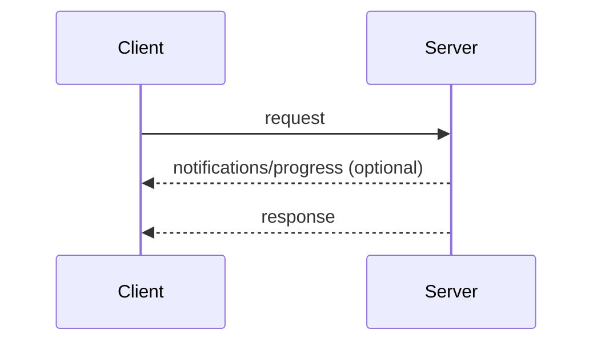
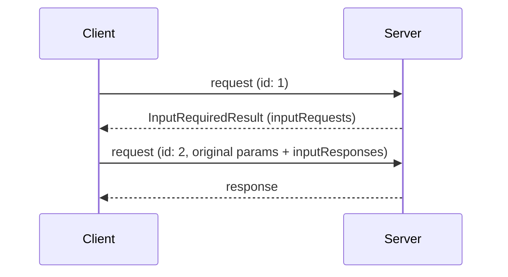
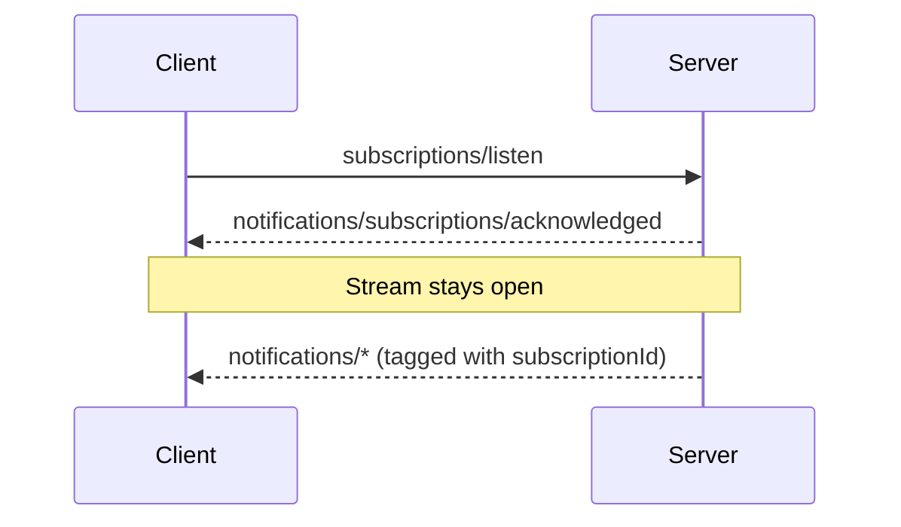

# Message Patterns Overview

The message patterns of the core protocol: the ways a client and server compose JSON-RPC requests, responses, and notifications into interactions. Every transport carries all of these patterns; transports differ only in how messages are framed and delivered.

## Signature / Usage

Request and Response, with optional request-scoped notifications:

Multi Round-Trip Requests:

Subscribe and Notify:

## Options / Props

| Pattern | Description | Page |
|---------|-------------|------|
| Request and Response | Client sends a request; server answers with a result or an error, optionally preceded by notifications scoped to that request (`notifications/progress`, `notifications/message`) | [progress.md](./progress.md) |
| Multi Round-Trip Requests | Server answers with `InputRequiredResult`; client retries with `inputResponses` | [mrtr.md](./mrtr.md) |
| Subscribe and Notify | Client sends `subscriptions/listen`; reply is a long-lived stream of the requested notification types | [subscriptions.md](./subscriptions.md) |

## Notes

- Every interaction begins with the client: the client sends JSON-RPC requests and notifications; the server answers each request with a JSON-RPC response (a result or error), optionally preceded by notifications scoped to that request.
- Servers **MUST NOT** initiate JSON-RPC requests, and clients do not send JSON-RPC responses.
- While a request is in flight, the server **MAY** send notifications scoped to it.
- Subscribe and Notify: stream state is scoped to the request; if the underlying channel is lost, the client re-issues the request.
- All core protocol features are built from these patterns. A protocol revision that adds a pattern defines it on this page. Transports carry new patterns without changes, because patterns are expressed entirely in terms of requests, responses, and notifications.
- Replaced in 2026-07-28: server-initiated requests are replaced by Multi Round-Trip Requests; the HTTP GET endpoint and `resources/subscribe` are replaced by `subscriptions/listen`.
- Source: tag `2026-07-28` raw (`docs/specification/2026-07-28/basic/patterns/index.mdx`).

## Related

- [Multi Round-Trip Requests (MRTR)](./mrtr.md)
- [Subscriptions](./subscriptions.md)
- [Cancellation](./cancellation.md)
- [Progress](./progress.md)
