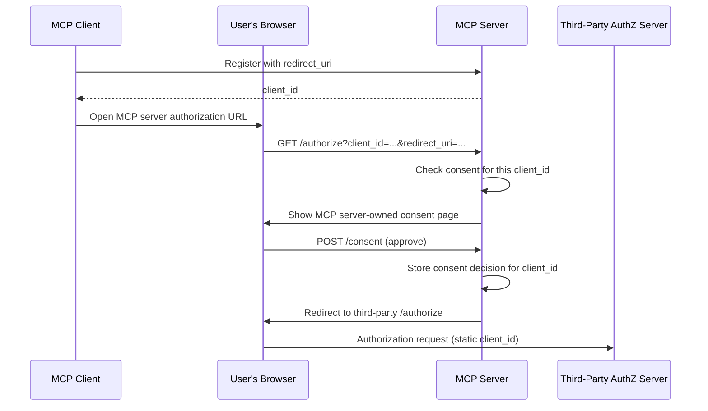

# Confused Deputy Problem

Attackers can exploit MCP proxy servers that connect to third-party APIs, obtaining authorization codes without proper user consent by exploiting the combination of static client IDs, dynamic client registration, and consent cookies.

## Signature / Usage

Mitigation flow: per-client consent at the MCP server runs before the third-party authorization flow.

## Options / Props

Terminology:

| Term | Meaning |
|------|---------|
| MCP Proxy Server | An MCP server that connects MCP clients to third-party APIs, acting as a single OAuth client to the third-party API server |
| Third-Party Authorization Server | Protects the third-party API; may lack dynamic client registration, so the proxy uses a static client ID |
| Third-Party API | The protected resource server; requires tokens issued by the third-party authorization server |
| Static Client ID | Fixed OAuth 2.0 client identifier the proxy uses with the third-party authorization server, the same for all MCP clients |

Vulnerable conditions (all must be present):

- MCP proxy server uses a **static client ID** with a third-party authorization server
- MCP proxy server allows MCP clients to **dynamically register** (each getting their own client_id)
- The third-party authorization server sets a **consent cookie** after the first authorization
- MCP proxy server does not implement proper per-client consent before forwarding to third-party authorization

## Notes

- Attack: user authenticates normally, third-party AS sets a consent cookie for the static client ID; attacker later sends a crafted authorization request with a malicious `redirect_uri` and a newly registered client ID; the cookie causes consent to be skipped and the MCP authorization code is redirected to the attacker.
- Mitigation: MCP proxy servers **MUST** implement per-client consent and proper security controls.
- Per-Client Consent Storage. MCP proxy servers **MUST**: maintain a registry of approved `client_id` values per user; check this registry **before** initiating the third-party authorization flow; store consent decisions securely (server-side database, or server specific cookies).
- Consent UI. The MCP-level consent page **MUST**: clearly identify the requesting MCP client by name; display the specific third-party API scopes being requested; show the registered `redirect_uri` where tokens will be sent; implement CSRF protection (e.g., state parameter, CSRF tokens); prevent iframing via `frame-ancestors` CSP directive or `X-Frame-Options: DENY`.
- Consent cookies. If used, they **MUST**: use `__Host-` prefix for cookie names; set `Secure`, `HttpOnly`, and `SameSite=Lax`; be cryptographically signed or use server-side sessions; bind to the specific `client_id`.
- Redirect URI validation. The proxy **MUST**: validate that `redirect_uri` exactly matches the registered URI; reject requests if it changed without re-registration; use exact string matching (not pattern matching or wildcards).
- OAuth `state`. Proxies **MUST**: generate a cryptographically secure random `state` per authorization request; store it server-side **only after** consent has been explicitly approved; set the state tracking cookie/session **immediately before** redirecting to the third-party identity provider; validate at the callback that `state` exactly matches the stored value; reject callbacks with missing or mismatched `state`; make `state` single-use with a short expiration (e.g., 10 minutes).
- The consent cookie or session containing `state` **MUST NOT** be set until **after** the user has approved the consent screen at the MCP server's authorization endpoint.
- Deprecated in 2026-07-28 (earliest removal: first revision on or after 2027-07-28): Dynamic Client Registration (see `deprecated.mdx` in the specification tag); the attack conditions above still apply wherever DCR is offered.
- Distance line: authorization requirements are in the authorization category of this skill; OAuth provider implementations live in better-auth and supabase.

## Related

- [token-passthrough.md](./token-passthrough.md)
- [oauth-redirect-attacks.md](./oauth-redirect-attacks.md)
- [security-best-practices.md](./security-best-practices.md)
