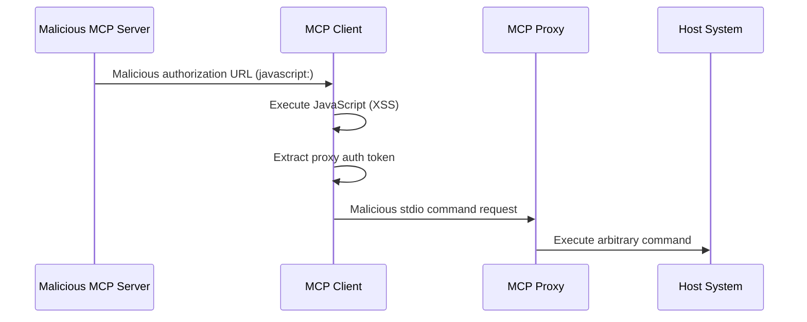

# OAuth URL Validation, Mix-Up and Redirect Attacks

Four related OAuth client-side and server-side attack areas: OAuth Authorization URL Validation, Mix-Up Attacks, Localhost Redirect URI Impersonation, and CIMD Trust Policies.

## Signature / Usage

Attack chain from a malicious authorization URL to stdio privilege escalation:

## Options / Props

URL scheme validation rules for authorization URLs:

| Requirement | Rule |
|-------------|------|
| **MUST** | only allow `http://` and `https://`; `http://` only for loopback (`localhost`, `127.0.0.1`, `::1`) during local development; production authorization servers **MUST** use `https://` |
| **MUST** | reject `javascript:`, `data:`, `file:`, `vbscript:`, and other potentially dangerous schemes |
| **SHOULD** | use allowlist-based validation rather than blocklist-based |
| **MUST NOT** | use shell commands (`cmd.exe`, `sh`, PowerShell) to open URLs |
| **SHOULD** | use platform-specific, non-shell URL opening mechanisms |

## Notes

- OAuth Authorization URL Validation. Attack vectors: JavaScript URL injection (XSS) when a client passes a `javascript:` URL to `window.open()`; command injection when a client opens URLs through a shell; stdio transport privilege escalation when XSS is combined with a proxy. Risks: XSS, RCE, privilege escalation, data exfiltration, persistence.
- Web-based clients **SHOULD** implement CSP: `script-src 'self'`, `default-src 'self'`, consider `script-src 'nonce-<random>'` for required inline scripts.
- Clients **MUST** sanitize and validate all URLs received from MCP servers: strict URL parsing, reject URLs with special characters interpretable by shells, consider URL sanitization libraries, log suspicious authorization URLs.
- Mix-Up Attacks. An attacker controlling one authorization server may try to have the client send it an authorization code or token issued by a different, honest authorization server (RFC9207 Section 1). Authorization Response Validation mitigates this by binding the response to the authorization server recorded before redirecting. PKCE alone does not prevent this because the client sends the `code_verifier` to the attacker's token endpoint; resource indicators do not help either. The mitigation depends on honest authorization servers emitting `iss` and gives no protection against one that does not.
- Localhost Redirect URI Impersonation. With Client ID Metadata Documents, the metadata document proves control of a domain but cannot prove which local process listens on a `localhost` redirect URI. An attacker supplies the legitimate client's metadata URL as `client_id`, binds any `localhost` port as `redirect_uri`, and receives the authorization code when the user approves. Countermeasures for authorization servers (extra warnings for `localhost`-only redirect URIs, clearly displaying the redirect URI hostname) are in "Localhost Redirect URI Risks" of the authorization security considerations.
- CIMD Trust Policies. Authorization servers accepting Client ID Metadata Documents can apply domain-based trust policies: allowlists for trusted domains (protected servers); accept any HTTPS `client_id` (open servers); reputation checks for unknown domains; restrictions based on domain age or certificate validation; display the CIMD and associated client hostnames prominently to prevent phishing. Servers keep full control over their access policies.
- Distance line: concrete OAuth provider implementations are in better-auth and supabase.

## Related

- [ssrf.md](./ssrf.md)
- [local-server-compromise.md](./local-server-compromise.md)
- [confused-deputy.md](./confused-deputy.md)
- [security-best-practices.md](./security-best-practices.md)
