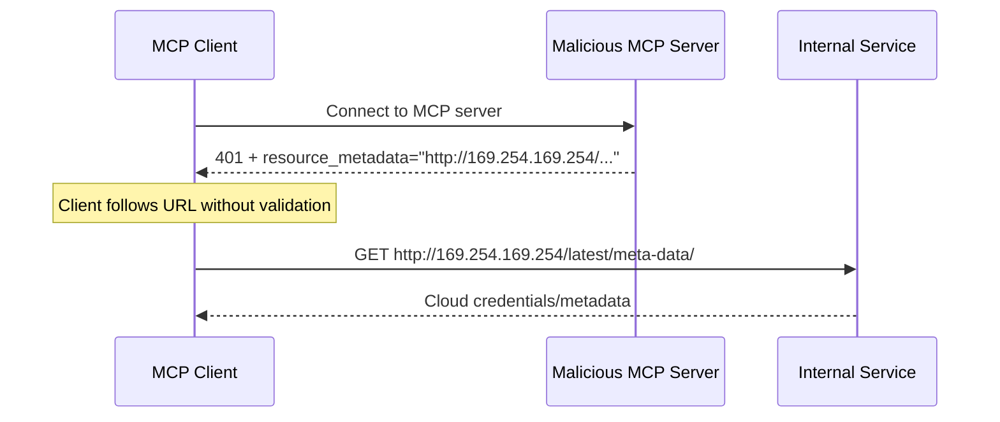

# Server-Side Request Forgery (SSRF)

An attacker can induce an MCP client to make HTTP requests to unintended destinations, potentially accessing internal network resources, cloud metadata endpoints, or other protected services.

## Signature / Usage

Attack sequence during OAuth metadata discovery:

## Options / Props

URL sources fetched during OAuth metadata discovery that a malicious server can control:

| Source | Field |
|--------|-------|
| `WWW-Authenticate` header | `resource_metadata` URL |
| Protected Resource Metadata | `authorization_servers` URLs |
| Authorization Server Metadata | `token_endpoint`, `authorization_endpoint`, and other URLs |

Attack patterns: direct internal IP access (`http://192.168.1.1/admin`), cloud metadata endpoints (`http://169.254.169.254/`), localhost services (`http://localhost:6379/`), DNS rebinding, redirect chains.

Private and reserved ranges to block (RFC 9728 Section 7.7):

| Range | Addresses |
|-------|-----------|
| Private IPv4 | `10.0.0.0/8`, `172.16.0.0/12`, `192.168.0.0/16` |
| Loopback | `127.0.0.0/8`, `::1` (except when explicitly allowed for development) |
| Link-local | `169.254.0.0/16` (including cloud metadata endpoints) |
| Private IPv6 | `fc00::/7`, `fe80::/10` |

## Notes

- Risks: credential exfiltration, internal network reconnaissance, service interaction (POST to token endpoints can mutate internal services), firewall bypass, data exfiltration via error messages or OAuth flows.
- MCP clients deployed to a server **MUST** consider SSRF risks and implement appropriate mitigations when fetching OAuth-related URLs.
- Enforce HTTPS: clients **SHOULD** require HTTPS for all OAuth-related URLs in production; reject `http://` except loopback (`localhost`, `127.0.0.1`, `::1`) during development; provide an explicit opt-out for development/testing.
- Block private IP ranges: clients **SHOULD** block the ranges above. Avoid implementing IP validation manually; attackers exploit encoding tricks (octal, hex, IPv4-mapped IPv6) that custom parsers often miss.
- Validate redirect targets: clients **SHOULD** apply the same URL validation to redirect targets; do not blindly follow redirects to internal resources; consider disabling automatic redirect following and validating each hop.
- Egress proxies: operators of server-side MCP client deployments **SHOULD** consider an egress proxy that enforces network policies (the page names Smokescreen).
- DNS resolution: beware TOCTOU between validation and use; consider pinning DNS resolution results between check and use; combine DNS checks with other mitigations.
- SSRF against authorization servers: an authorization server that supports Client ID Metadata Documents fetches a URL supplied by an unknown client, so the same mitigations apply to it.
- Resources named: OWASP SSRF Prevention Cheat Sheet; OWASP Top 10 A10:2021 SSRF.

## Related

- [security-best-practices.md](./security-best-practices.md)
- [oauth-redirect-attacks.md](./oauth-redirect-attacks.md)
