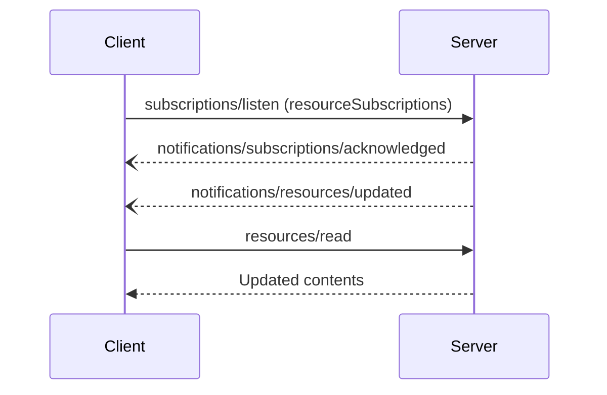

# Resource List Changed and Subscriptions

Servers notify clients when the resource list changes and when specific watched resources are updated. Per-resource updates are requested via `subscriptions/listen`.

## Signature / Usage

List changed notification (servers that declared `listChanged` **SHOULD** send it):

```json
{
  "jsonrpc": "2.0",
  "method": "notifications/resources/list_changed"
}
```

Clients subscribe by sending a `subscriptions/listen` request with resource URIs in `notifications.resourceSubscriptions`. The server delivers `notifications/resources/updated` on the resulting stream whenever a watched resource changes:

```json
{
  "jsonrpc": "2.0",
  "method": "notifications/resources/updated",
  "params": {
    "_meta": { "io.modelcontextprotocol/subscriptionId": 4 },
    "uri": "file:///project/src/main.rs"
  }
}
```

Message flow (from the spec):



## Options / Props

Resources capability features:

| Name | Type | Description |
|------|------|-------------|
| `listChanged` | boolean | Whether the server will emit notifications when the list of available resources changes |
| `subscribe` | boolean | Whether the server supports resource-specific update notifications for resources requested through `subscriptions/listen` using the `resourceSubscriptions` filter |

## Notes

- See the Subscriptions pattern page for the full mechanics (acknowledgment, `subscriptionId` correlation, cancellation).
- Replaced in 2026-07-28: `resources/subscribe` / `resources/unsubscribe` were removed in favor of `subscriptions/listen`; the HTTP GET endpoint was likewise replaced.
- Source: tag `2026-07-28` raw (`docs/specification/2026-07-28/server/resources.mdx`, sections List Changed Notification and Subscriptions).

## Related

- [Resources](./resources.md)
- [Resource Templates](./resource-templates.md)
- [Caching](./caching.md)
