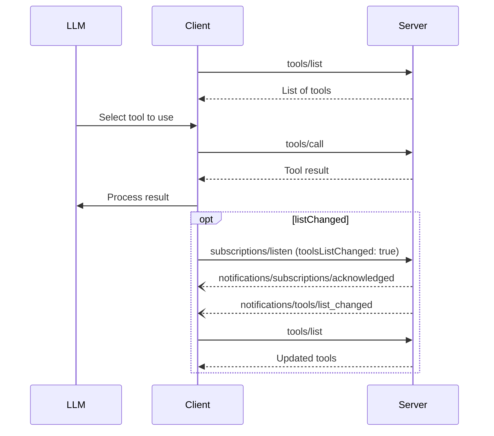

# Tools

Servers expose tools that language models can invoke (querying databases, calling APIs, computing). Each tool is identified by a unique name and carries schema metadata. Tools are model-controlled.

## Signature / Usage

Capability declaration:

```json
{
  "capabilities": {
    "tools": {
      "listChanged": true
    }
  }
}
```

`tools/list` (supports pagination and caching):

```json
{
  "jsonrpc": "2.0",
  "id": 1,
  "method": "tools/list",
  "params": { "cursor": "optional-cursor-value" }
}
```

```json
{
  "jsonrpc": "2.0",
  "id": 1,
  "result": {
    "resultType": "complete",
    "tools": [
      {
        "name": "get_weather",
        "title": "Weather Information Provider",
        "description": "Get current weather information for a location",
        "inputSchema": {
          "type": "object",
          "properties": {
            "location": { "type": "string", "description": "City name or zip code" }
          },
          "required": ["location"]
        },
        "icons": [
          { "src": "https://example.com/weather-icon.png", "mimeType": "image/png", "sizes": ["48x48"] }
        ]
      }
    ],
    "nextCursor": "next-page-cursor",
    "ttlMs": 300000,
    "cacheScope": "public"
  }
}
```

`tools/call`:

```json
{
  "jsonrpc": "2.0",
  "id": 2,
  "method": "tools/call",
  "params": {
    "name": "get_weather",
    "arguments": { "location": "New York" }
  }
}
```

```json
{
  "jsonrpc": "2.0",
  "id": 2,
  "result": {
    "resultType": "complete",
    "content": [
      {
        "type": "text",
        "text": "Current weather in New York:\nTemperature: 72°F\nConditions: Partly cloudy"
      }
    ],
    "isError": false
  }
}
```

List changed notification (sent to clients with a `subscriptions/listen` stream opened with `toolsListChanged: true`):

```json
{
  "jsonrpc": "2.0",
  "method": "notifications/tools/list_changed"
}
```

Message flow:



## Notes

- Servers that support tools **MUST** declare the `tools` capability. `listChanged` indicates whether the server will emit notifications when the list changes.
- `tools/list` **MAY** be empty and **MAY** change over time, but **MUST NOT** vary per-connection or as a side effect of other requests. The set **MAY** vary by the authorization presented on the request.
- Servers **SHOULD** return tools in a deterministic order (enables reliable client caching and improves LLM prompt cache hit rates).
- For trust and safety, there **SHOULD** always be a human in the loop with the ability to deny tool invocations. Applications **SHOULD** provide UI that makes clear which tools are exposed, insert visual indicators when tools are invoked, and present confirmation prompts.
- Every request **MUST** include the required `_meta` fields; the examples omit them for brevity.
- Replaced in 2026-07-28: the list-changed notification is delivered through `subscriptions/listen` (`toolsListChanged`); results require `resultType` and cache hints.
- Source: tag `2026-07-28` raw (`docs/specification/2026-07-28/server/tools.mdx`).

## Related

- [Tool Definition](./tool-definition.md)
- [Tool Result and Input Required Results](./tool-result.md)
- [Stateful Tools and Tool Error Handling](./tool-errors-and-state.md)
- [Pagination](./pagination.md)
- [Caching](./caching.md)
