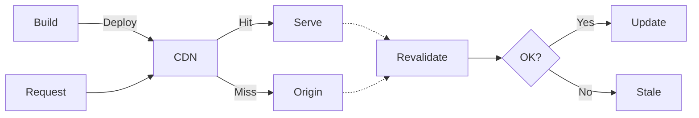

# Incremental Static Regeneration (ISR)

A caching strategy combining static content speed with server-side rendering flexibility. Serves cached responses while regenerating content in the background on a schedule or via API trigger (stale-while-revalidate).

## How to Enable by Framework

| Framework | Method |
|-----------|--------|
| Next.js App Router | `export const revalidate = N` (seconds) in route segment |
| Next.js Pages Router | Return `revalidate: N` from `getStaticProps` |
| SvelteKit | `export const config = { isr: { expiration: N } }` |
| Nuxt | `routeRules: { '/path': { isr: N } }` in config |
| Astro | Configure server output with ISR adapter option |
| Gatsby | Deferred Static Generation (DSG) |
| Build Output API | Define Prerender Functions |

## ISR Lifecycle

| Stage | Behavior |
|-------|---------|
| Build time | Vercel analyzes routes; distributes cacheability metadata to all CDN regions |
| Cache hit | CDN serves cached response immediately; function not invoked |
| Cache miss | Request forwarded to function region; checked in durable ISR cache; function invoked if needed |
| Revalidation | Background regeneration; visitors get stale content until new version ready |
| Failure | Stale content preserved; 30-second TTL retry. Failure = network errors, any status other than 200, 301, 302, 307, 308, 404, 410, or function execution / runtime errors |

## Vercel CDN Benefits

| Feature | Description |
|---------|-------------|
| Durable storage | ISR cache persists for the duration you specify, until revalidated or until it goes unaccessed for 31 days; scoped per deployment |
| Cache shielding | CDN miss reads from ISR cache before invoking function |
| Request collapsing | Multiple concurrent requests to same uncached path collapsed into one invocation |
| Global purging | Revalidation propagates to all regions within 300ms |
| Selective pre-rendering | Pre-render popular paths at build time; generate others on demand |
| Instant rollbacks | Previous deployment caches preserved; new deployments use own cache |

## Revalidation Triggers

1. **Time-based**: automatic after set interval (e.g., `revalidate = 60` = revalidate every 60 seconds)
2. **On-demand**: call the revalidation API programmatically

### On-Demand Revalidation Scope

- `res.revalidate` (Next.js Pages Router) and the `x-prerender-revalidate` request header (SvelteKit, Nuxt) apply to the specific domain and deployment only
- They do **not** affect subdomains or other deployments
- Example: revalidating `example.com/page` does not revalidate `sub.example.com/page`
- Tag-based revalidation (`revalidateTag`, `revalidatePath` in the Next.js App Router) applies to every domain and deployment in the same project and environment

## Pricing Components

| Cost Item | Trigger |
|-----------|---------|
| Function invocations | Background revalidation or on-demand revalidation calls |
| ISR writes | Fresh content persisted to durable storage |
| ISR reads | CDN miss reads from ISR cache |
| Fast Origin Transfer | Data transferred from function region |

## Notes

- Source: https://vercel.com/docs/incremental-static-regeneration (fetched 2026-11-14)
- ISR is available on all plans; it is one of four caching approaches (ISR, `Cache-Control` headers on APIs, image optimization, external origins via rewrites) plus Runtime Cache for data inside functions
- ISR cache is scoped per deployment; each new deployment gets its own cache
- ISR cache region follows the project's default function region (`iad1` by default)
- Request collapsing (docs page `/docs/incremental-static-regeneration/request-collapsing`): when requests arrive while the first function invocation for an uncached path is still running, the CDN collapses them into the original one (within the same region); they wait and all receive the same result, preventing a cache stampede. It also applies when serving STALE responses (stale-while-revalidate), collapsing concurrent background revalidations into one invocation. Supported for ISR and Image Optimization
- The `revalidate` / `isr.expiration` / `routeRules` ISR configuration forms in the table above match the current ISR docs (Nuxt: `routeRules` with the `isr` option; checked against the 2026-10 docs page)
- `Cache-Control` headers alone do not enable request collapsing, durable storage, or 300ms global purges
- Data caching inside functions (per-fetch, per-query) uses Runtime Cache separately from ISR

## Related

- [regions.md](./regions.md)
- [overview.md](./overview.md)
